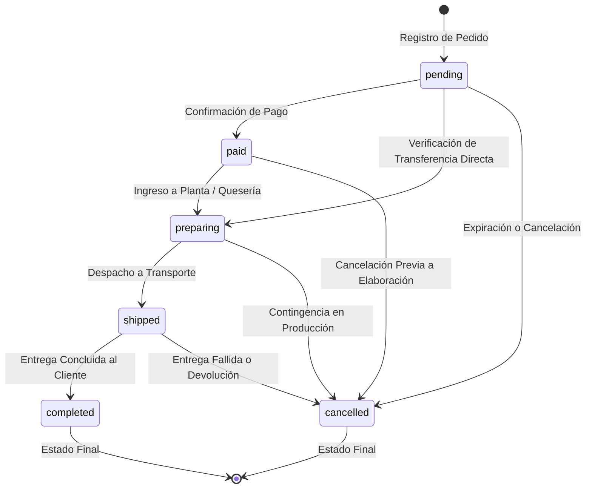

# BE-33 - Transición de Estados de Orden y Auditoría (`audit_log`)

Documentación técnica de la implementación del endpoint para control de la máquina de estados de pedidos y registro inmutable en `public.audit_log`, correspondiente a la **Semana 7: Gestión Administrativa, 2FA y Auditoría** de la plataforma CONLAC-T.

---

## 1. Convenciones Globales y Seguridad

- **URL Base:** `http://localhost:8080` (Backend Spring Boot) / `http://localhost:3000` (Next.js Frontend).
- **Rutas con Soporte Dual (Español / Inglés):**
  - Administrativas principales: `/api/admin/pedidos/{id}/estado` y `/api/admin/orders/{id}/status`.
  - Rutas de compatibilidad: `/api/pedidos/{id}/estado` y `/api/orders/{id}/status`.
- **Autenticación y Autorización:**
  - Requiere cabecera `Authorization: Bearer <supabase_jwt_token>` con rol verificado `admin` y perfil activo (`is_active = true`) en la tabla `profiles`.
  - Las peticiones anónimas o sin credenciales de administrador son rechazadas con `401 Unauthorized` o `403 Forbidden`.
- **Transaccionalidad Atómica:**
  - El cambio de estado del pedido, la actualización de pagos/reservas de stock y la inserción en `audit_log` ocurren dentro de la misma transacción de base de datos (`@Transactional`). Si la auditoría o la persistencia fallan, todo el proceso se revierte automáticamente.
- **Normalización Tolerante de Entradas:**
  - El payload acepta identificadores en español o inglés (`PENDIENTE`, `PAGADO`, `EN_PREPARACION`, `ENVIADO`, `ENTREGADO`, `CANCELADO`, o `pending`, `paid`, `preparing`, `shipped`, `completed`, `cancelled`), sin distinguir mayúsculas/minúsculas ni acentos.

---

## 2. Catálogo de Endpoints (BE-33)

| Método | Ruta en Español | Alias en Inglés | Seguridad | Código Éxito | Descripción |
|---|---|---|---|---|---|
| **PATCH** | `/api/admin/pedidos/{id}/estado` | `/api/admin/orders/{id}/status` | Admin (`ROLE_ADMIN`) | `200 OK` | Ejecuta la transición de estado del pedido y genera el registro en `audit_log` |
| **PATCH** | `/api/pedidos/{id}/estado` | `/api/orders/{id}/status` | Admin (`ROLE_ADMIN`) | `200 OK` | Alias de compatibilidad para actualización de estado por administradores |
| **GET** | `/api/admin/pedidos` | `/api/admin/orders` | Admin (`ROLE_ADMIN`) | `200 OK` | Listado administrativo de pedidos con filtro opcional `?estado=` |

---

## 3. Máquina de Estados del Pedido

La máquina de estados garantiza que una orden de compra transite únicamente por fases lógicas y permitidas dentro de la cadena de valor de los productos lácteos:



### Reglas de Negocio por Estado:
1. **Transición a `cancelled` (Cancelación):**
   - Libera automáticamente cualquier reserva temporal de inventario (`ReservationStatus.released`).
   - Restituye de inmediato el stock físico disponible a cada presentación (`ProductVariant.addStock`).
   - Marca cualquier pago pendiente en estado `rejected`.
2. **Transición a `paid` o `preparing`:**
   - Marca el pago asociado como aprobado (`PaymentStatus.approved`).
   - Consolida las reservas de inventario activas a consumidas (`ReservationStatus.consumed`).
3. **Estados Terminales:**
   - Un pedido en estado `completed` o `cancelled` no puede ser modificado. Cualquier intento de cambio dispara `400 Bad Request`.
4. **Intento de Transición al Mismo Estado:**
   - Si la orden ya se encuentra en el estado solicitado, la API responde `400 Bad Request` indicando que el pedido ya posee dicho estado, evitando la polución de eventos redundantes en `audit_log`.

---

## 4. Especificación de Cargas Útiles (Payloads)

### A. Solicitud de Transición de Estado (`PATCH /api/admin/pedidos/{id}/estado`)
- **Headers:** `Authorization: Bearer <token>`, `Content-Type: application/json`
- **Request Body:**
```json
{
  "nuevo_estado": "preparing",
  "notas_administrativas": "Transferencia Banco Pichincha #458921 confirmada en cuenta."
}
```

- **Campos del Request:**
  - `nuevo_estado` *(obligatorio, string)*: Nombre del estado destino. Admite alias: `status`, `new_status`, `estado`.
  - `notas_administrativas` *(opcional, string)*: Motivo o detalle del cambio administrativo. Admite alias: `administrative_notes`, `notes`, `notas`.

- **Response Body (`200 OK`):**
```json
{
  "id": "71c94fa4-90e5-4306-ad5b-4f01341857d7",
  "numero_pedido": 10042,
  "estado_anterior": "pending",
  "estado_actual": "preparing",
  "notas_administrativas": "Transferencia Banco Pichincha #458921 confirmada en cuenta.",
  "updated_at": "2026-10-25T01:30:00Z"
}
```

---

## 5. Estructura y Registro en `public.audit_log`

Cada transición de estado exitosa registra de forma inmutable una fila en la tabla de auditoría:

| Columna | Tipo SQL | Valor Asignado |
|---|---|---|
| `actor_user_id` | `uuid` | ID del usuario autenticado extraído del JWT (`UserPrincipal.getId()`) |
| `entity_name` | `text` | `"orders"` |
| `entity_id` | `text` | UUID del pedido (`order.getId().toString()`) |
| `action` | `text` | `"ORDER_STATUS_UPDATE"` |
| `old_data` | `jsonb` | `{"status": "pending"}` |
| `new_data` | `jsonb` | Objeto JSON con `{ "status", "usuario", "rol", "timestamp", "notas_administrativas" }` |
| `created_at` | `timestamptz` | Fecha y hora UTC del evento generada por PostgreSQL |

### Ejemplo del campo `new_data` persistido:
```json
{
  "status": "preparing",
  "usuario": "admin@conlact.org",
  "rol": "admin",
  "timestamp": "2026-10-25T01:30:00.123456-05:00",
  "notas_administrativas": "Transferencia Banco Pichincha #458921 confirmada en cuenta."
}
```

---

## 6. Pruebas Automatizadas

1. **Pruebas Unitarias de Servicio (`OrderServiceTest`):**
   - Transición `pending` a `preparing` con persistencia en `audit_log`.
   - Transición de cancelación con restitución de stock a la variante.
   - Rechazo de transiciones prohibidas (`completed` a `pending`).
   - Rechazo de petición al mismo estado.
   - Normalización de cadenas en español con tildes y mayúsculas (`EN_PREPARACIÓN`, `CANCELADO`, etc.).
2. **Pruebas de Controlador (`AdminOrderControllerTest`):**
   - Validación de contratos HTTP y respuestas JSON `200 OK`.
   - Soporte de rutas en español e inglés.
   - Bean Validation ante campos requeridos vacíos (`400 Bad Request`).
   - Control de excepciones `404 Not Found` y `400 Bad Request`.
3. **Pruebas de Integración con Base de Datos (`OrderStatusAuditIntegrationTest`):**
   - Ejecución end-to-end sobre PostgreSQL real de Testcontainers.
   - Verificación de inserción en tabla física `audit_log` comprobando `actor_user_id`, `old_data` y `new_data`.
   - Rechazo de peticiones anónimas con `401 Unauthorized`.
