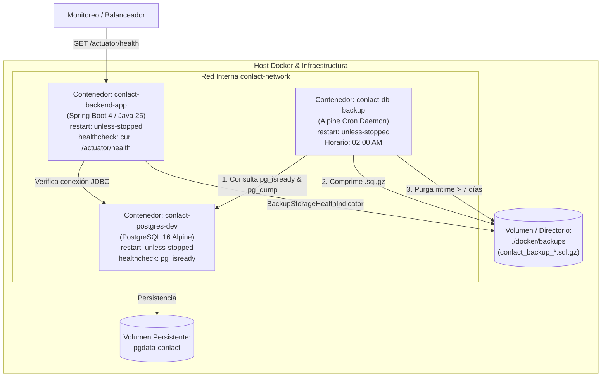

# Documentación Técnica — [BE-39] Configuración de Backups y Resiliencia

**Consorcio de Lácteos de Tungurahua (CONLAC-T)**  
**Semana 8:** Despliegue en Producción y Cierre  
**Responsable:** Maybelline Navarro  
**Tecnología:** Docker Multi-Container / PostgreSQL 16 Alpine / Spring Boot Actuator / Bash & PowerShell / Cron / Gzip

---

## 1. Resumen de la Implementación

El ticket **[BE-39]** establece la infraestructura de **resiliencia operativa, monitoreo de salud en vivo y políticas de respaldo automatizado** de la base de datos PostgreSQL del consorcio.

Se implementaron tres componentes principales:

1. **Monitoreo de Salud con Spring Boot Actuator (`/actuator/health`):**
   - Incorporación de dependencias Actuator nativas para Spring Boot 4.x / Java 25.
   - Exposición pública de los endpoints `/actuator/health` y `/actuator/info` (con exclusión de sondeo SMTP cuando `MAIL_ENABLED=false` para evitar estados DOWN espurios).
   - Componente personalizado `BackupStorageHealthIndicator` que analiza el directorio de respaldos, informando en tiempo real si el almacenamiento está listo (`READY`) o activo (`ACTIVE`), el número de copias encontradas, tamaño total y fechas del respaldo más reciente y más antiguo.
   - Protección con rol `ADMIN` para métricas avanzadas y configuraciones internas bajo `/actuator/**`.

2. **Servicio y Scripts de Respaldo Automatizado con Política de Retención:**
   - Script Bash POSIX (`docker/backup/backup.sh`) con ejecución de `pg_dump`, verificación de conectividad con `pg_isready`, compresión en stream `.sql.gz` y purga automatizada (`find -mtime +N -exec rm`) basada en la variable `BACKUP_RETENTION_DAYS`.
   - Script PowerShell (`docker/backup/backup-postgres.ps1`) para administración local y entornos Windows con compresión GZip nativa de .NET.
   - Demonio Cron en contenedor Docker dedicado (`docker/backup/Dockerfile.backup` y `entrypoint.sh`), programado por defecto para ejecutarse a las 02:00 AM (`0 2 * * *`) con respaldo inicial de verificación al arranque.

3. **Resiliencia de Contenedores y Healthchecks Nativos:**
   - En `Dockerfile`: adición de directiva `HEALTHCHECK` consultando `curl -f http://localhost:8080/actuator/health`.
   - En `docker-compose.yml`:
     - Contenedor de base de datos con `pg_isready` y política `restart: unless-stopped`.
     - Contenedor backend con dependencia `condition: service_healthy` sobre PostgreSQL, política de reinicio `restart: unless-stopped` y sondeo healthcheck de Actuator.
     - Contenedor de backups `conlact-db-backup` integrado a la red interna con montaje de volumen persistente.

---

## 2. Diagrama de Arquitectura de Resiliencia y Respaldos



---

## 3. Especificación del Endpoint `/actuator/health`

### Respuesta de Ejemplo (200 OK — Estado UP)

```json
{
  "status": "UP",
  "components": {
    "db": {
      "status": "UP",
      "details": {
        "database": "PostgreSQL",
        "validationQuery": "isValid()"
      }
    },
    "backupStorage": {
      "status": "UP",
      "details": {
        "storageStatus": "ACTIVE",
        "backupDirectory": "/app/docker/backups",
        "retentionPolicyDays": 7,
        "totalBackupsFound": 3,
        "totalStorageBytes": 458920,
        "newestBackupFile": "conlact_backup_conlact_local_20261030_020000.sql.gz",
        "newestBackupDate": "2026-10-30T02:00:15-05:00",
        "oldestBackupFile": "conlact_backup_conlact_local_20261028_020000.sql.gz",
        "oldestBackupDate": "2026-10-28T02:00:10-05:00"
      }
    },
    "diskSpace": {
      "status": "UP",
      "details": {
        "total": 1024208138240,
        "free": 818372739072,
        "threshold": 10485760,
        "exists": true
      }
    },
    "ping": {
      "status": "UP"
    }
  },
  "groups": [
    "liveness",
    "readiness"
  ]
}
```

---

## 4. Batería de Pruebas Automatizadas

Se agregaron pruebas dedicadas que se validaron junto a la suite completa del proyecto (311 pruebas en total, 0 fallos):

1. **Pruebas Unitarias (`BackupStorageHealthIndicatorTest`):**
   - Validación de estado `READY` ante directorio vacío recién inicializado.
   - Validación de estado `ACTIVE` con cálculo dinámico de tamaños, archivo más reciente y más antiguo.
   - Creación automática de directorios de almacenamiento si no existen previamente.
2. **Pruebas de Integración (`ActuatorHealthIntegrationTest`):**
   - Disponibilidad pública sin token JWT de `/actuator/health` (HTTP 200 OK con `status = UP`).
   - Disponibilidad pública de información de la aplicación `/actuator/info`.
   - Protección estricta con código 401/403 para endpoints administrativos sensibles de Actuator (`/actuator/beans`, `/actuator/env`, etc.).
